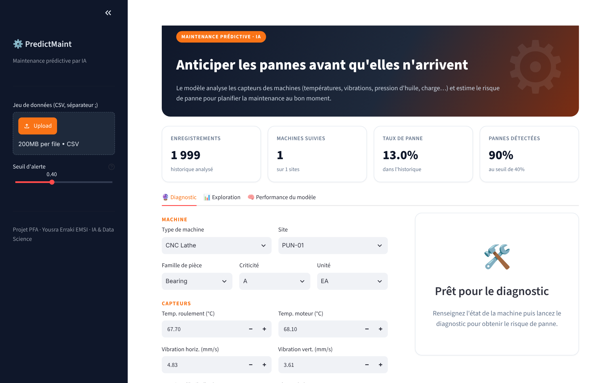
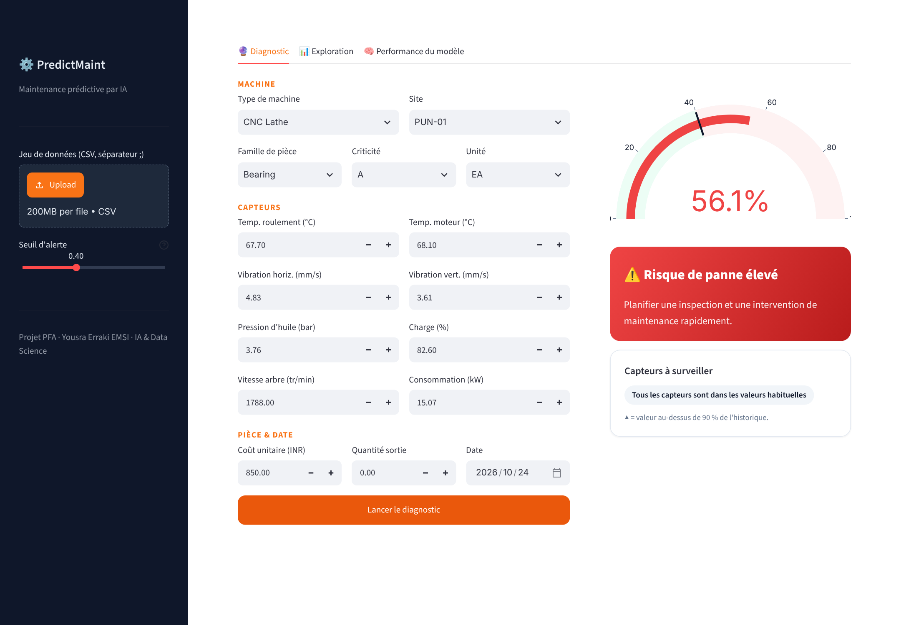
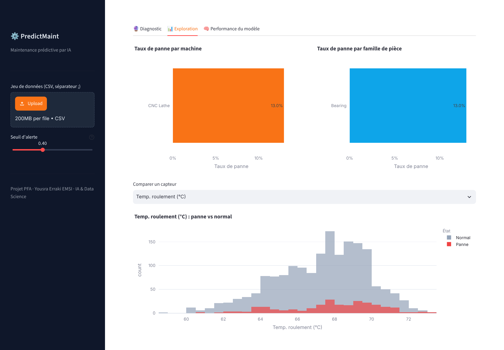

# ⚙️ PredictMaint – Maintenance prédictive par IA

Projet PFA – **Yousra Erraki** · EMSI (Ingénierie Informatique, IA & Data Science)

Prédiction des pannes de machines industrielles (presses hydrauliques, tours CNC, ponts roulants…) à partir des **données capteurs** (températures, vibrations, pression d'huile, charge, vitesse, consommation) et des informations sur les pièces.

## Contenu

| Fichier | Description |
|---|---|
| `PFA.ipynb` | Notebook : préparation des données, rééquilibrage des classes, comparaison de 5 modèles (SVM, KNN, Decision Tree, Random Forest, ANN) |
| `app.py` | Application Streamlit : diagnostic d'une machine, exploration des données, performance du modèle |
| `requirements.txt` | Dépendances Python |

## Approche

- Rééquilibrage du jeu de données (3 non-pannes pour 1 panne)
- Variables temporelles (mois, saison) et encodage des variables catégorielles
- Comparaison de 5 algorithmes ; **Random Forest** retenu (meilleur F1-score pondéré dans le notebook)
- Seuil d'alerte réglable : le baisser permet de rater moins de pannes, au prix de plus de fausses alertes

## Application

- **Diagnostic** : saisie de l'état d'une machine → jauge de risque de panne + capteurs à surveiller
- **Exploration** : taux de panne par machine et par famille de pièce, distribution des capteurs
- **Performance** : accuracy, précision, rappel, F1, matrice de confusion, variables les plus influentes

## Lancer l'application

```bash
pip install -r requirements.txt
streamlit run app.py
```

Placer `DataPiece.csv` (séparateur `;`) dans le même dossier que `app.py`, ou le charger depuis la barre latérale.

## Technologies

Python · Pandas · NumPy · Scikit-learn · TensorFlow/Keras · Streamlit · Plotly

## Captures




